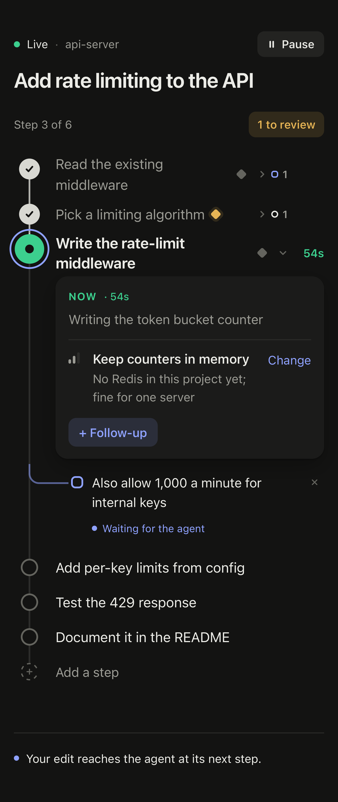

# Status Page for Claude Code

A calm live page for long Claude Code tasks: the agent's steps as one map, from done to now to next. **Edit a step, add a follow-up, or override a decision, and the running agent follows at its next step.**

<p>
  
  
</p>

## Install

```bash
claude plugin marketplace add Sharath-majjigi/agent-status-page && claude plugin install status-page@agent-status-page
```

Needs Node 18+. Sessions you start after installing get everything. In a session that was already open, run `/status-page:open`: Claude keeps the page current through a small command instead of its usual tools, and your edits reach it. Run `/reload-plugins` there too to also get edits between steps and Pause.

## Use

Give Claude any multi-step task and open the page with `/status-page:open`. The map fills in by itself from the task list Claude already keeps (the desktop app's list, or its to-dos in the terminal), so it never goes blank while Claude works. Claude adds its decisions on top.

- **The map:** every step on one line, with what's done, what's running now, and what's next. Tap a step to open it: what it's doing and the decisions made there. Unsure decisions are marked *review*; click **Change** to say what to do instead.
- **Next up:** rename, reorder (drag or Move up/down), remove, or add steps.
- **Follow-ups:** add one to any step, even a finished one, and it branches off the map as a blue square: waiting, then *agent has it*, then done. Branches fold into a small badge once they're done; click it to open them.
- **Side sessions:** sessions the agent starts show as linked branches with their own progress. Click one to open its page.
- **Pause and Resume:** Pause stops the agent at its next step (whatever it is running finishes first). While it's paused, your edits wait. Resume wakes it where it left off, edits included. Typing to Claude also resumes it.
- **Earlier:** finished tasks from the same session, folded away.

Your edits reach the agent between its steps. In an open session, they wake it up even after it has stopped.

## How it works

A plugin with three parts: an MCP server with a few small tools the agent uses to update the page, hooks that hand your edits to the agent between steps (and notice the side sessions it starts), and a tiny local server that streams the page live. No dependencies, no accounts, no network calls.

## Privacy

The server listens on `127.0.0.1` only. Every request needs a random token that lives in `~/.agent-status-page/token` and in your page link, so nothing else on your network can read the page or steer the agent. State is kept in `~/.agent-status-page/`.

## Uninstall

```bash
claude plugin uninstall status-page@agent-status-page
```

MIT License
