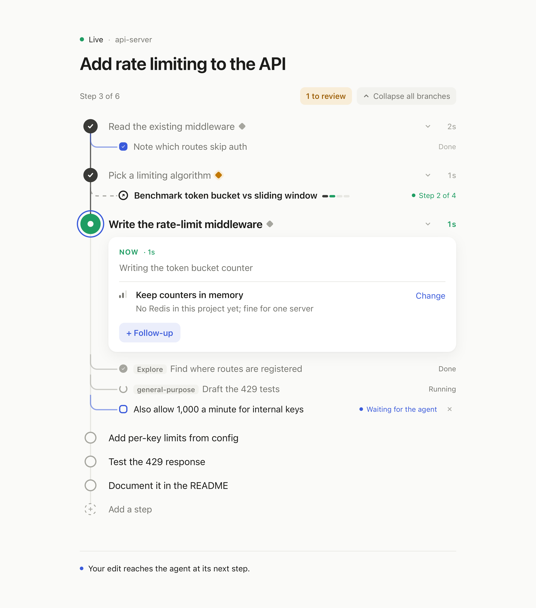

# Status Page for Claude Code

A calm live page for long Claude Code tasks. It shows what the agent is doing now, the decisions it made, and what's next. **Edit the plan or override a decision on the page, and the running agent follows at its next step.**

<p>
  
  
</p>

## Install

```bash
claude plugin marketplace add Sharath-majjigi/agent-status-page && claude plugin install status-page@agent-status-page
```

Needs Node 18+. Restart Claude Code after installing.

## Use

Give Claude any multi-step task. It shares a link to the page in its first update. You can also open the page any time with `/status-page:open`.

- **Now:** the step in progress and the file it's in, on a track with finished and upcoming steps.
- **Decisions:** each choice with a one-line reason. Unsure ones are marked *review*. Click **Change** to tell it what to do instead.
- **Next up:** click a step to edit it, drag to reorder, × to remove, or add your own.

Your edits reach the agent between its steps. In an open session, they wake it up even after it has stopped.

## How it works

A plugin with three parts: an MCP server with four small tools the agent uses to update the page, hooks that hand your edits to the agent between steps, and a tiny local server that streams the page live. No dependencies, no accounts, no network calls.

## Privacy

The server listens on `127.0.0.1` only. Every request needs a random token that lives in `~/.agent-status-page/token` and in your page link, so nothing else on your network can read the page or steer the agent. State is kept in `~/.agent-status-page/`.

## Uninstall

```bash
claude plugin uninstall status-page@agent-status-page
```

MIT License
